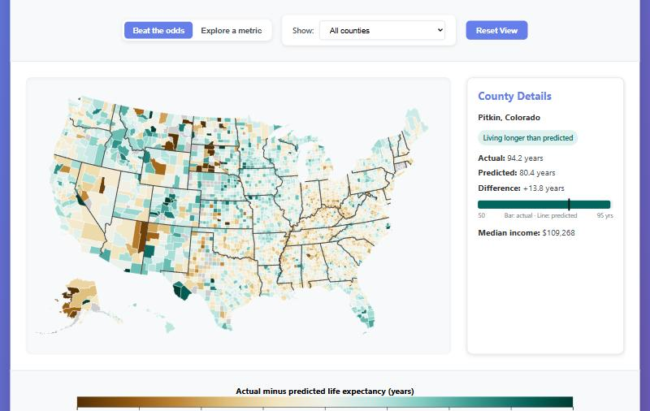
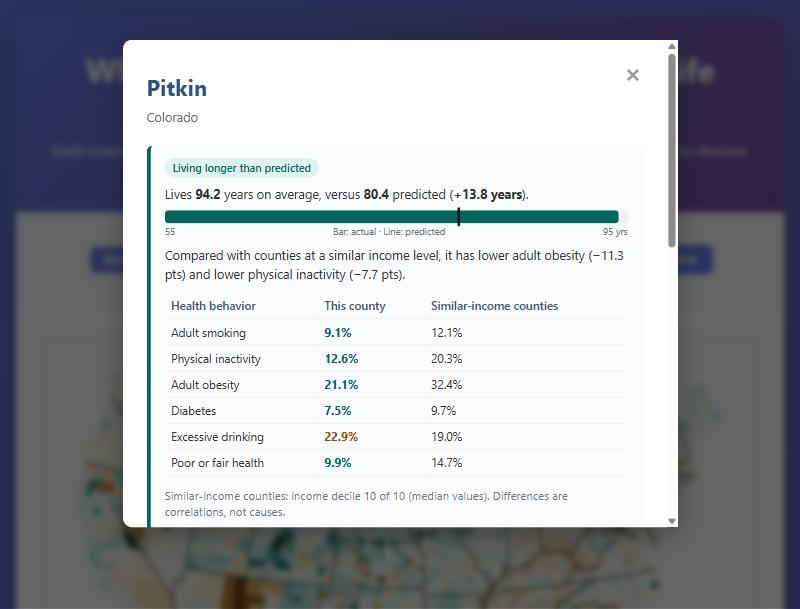

# Which U.S. Counties Beat the Odds on Life Expectancy?

[](https://aryaharsh5559.github.io/us-county-health-map/)

**Live site:** [aryaharsh5559.github.io/us-county-health-map/](https://aryaharsh5559.github.io/us-county-health-map/)

Richer counties live longer; that part is well known. This interactive D3.js map asks the more useful question: **which counties live much longer, or much shorter, than their income and access to care would predict?** A model trained on socioeconomic data alone predicts each county's life expectancy, and the map shows the gap between actual and predicted for 3,060 U.S. counties.



## Features

- **"Beat the odds" map:** a diverging color scale shows how many years each county lives above (teal) or below (brown) its prediction. Filter to just the counties living longer than predicted, close to prediction, or shorter.
- **County profile:** click any county to see actual vs predicted life expectancy, plus its smoking, physical inactivity, obesity, diabetes, drinking and self-rated health compared with counties at a similar income level. A one-line summary highlights the biggest differences.
- **Ranked lists:** the ten counties furthest above and below their prediction, each clickable.
- **Single-metric view:** switch to any of 12 health and socioeconomic metrics with its own sequential color scale.
- **Works on phones:** the map, legend and lists resize for narrow screens.



## How the prediction works

`build_deviation_data.py` predicts 2024 life expectancy from three socioeconomic measures: median household income (log scale), the uninsured rate, and primary care physicians per 100,000 residents (log scale). Health behaviors are left out of the model on purpose, because they are part of *how* a county ends up above or below its prediction; the site uses them to explain gaps rather than to predict them.

Every county's prediction is **out-of-fold**: it comes from a model trained on the other 80% of counties (5-fold cross-validation), so no county is scored by a model that has seen it. Three models were compared:

| Model | Out-of-fold R² | Mean absolute error |
|---|---|---|
| Linear regression, income only | 0.53 | 1.84 years |
| Linear regression, 3 socioeconomic features | 0.54 | 1.80 years |
| **Gradient boosting, 3 socioeconomic features** (used) | **0.58** | **1.71 years** |

Counties more than two years above or below their prediction are labeled as living longer or shorter than predicted: 491 above, 2,105 close to prediction and 464 below. Income peers are the counties in the same national income decile.

## Key findings

- **The biggest overperformers are mountain resort and rural Plains counties.** Mono County, California (+14.8 years) and Pitkin (+13.8) and Summit (+12.2) counties in Colorado top the list. Colorado, Idaho and Nebraska average 1.6–2.0 years above prediction.
- **The biggest underperformers are concentrated on Native American reservations and in Appalachia.** Buffalo (−16.0), Dewey (−14.3) and Oglala Lakota (−12.8) counties in South Dakota fall furthest short. In Kentucky, 45% of counties are 2+ years below prediction, and Tennessee and West Virginia are close behind (37% and 42%).
- **Health behaviors line up with the gap.** Counties living longer than predicted have lower median smoking (16.2% vs 19.2%), physical inactivity (25.9% vs 29.0%) and obesity (37.5% vs 39.9%) than counties living shorter than predicted. These are correlations, not causes.
- **Income alone explains about half the variation** (R² = 0.53); adding insurance and access to care, plus a non-linear model, raises that only to 0.58. Much of what separates counties is not captured by economics.

Counties with very small populations have noisy life expectancy estimates, so treat the most extreme values with caution.

## Exploratory analysis

`exploratory_analysis.py` produces six static charts in `exploratory_figures/`, including a correlation heatmap and a random-forest feature-importance chart. Using seven measures that include health behaviors, median household income carries 44% of the importance for predicting life expectancy, followed by physical inactivity (20%) and smoking (11%), with a cross-validated R² of 0.63.

## Data

- **County Health Rankings & Roadmaps, 2025 release (v3)** for all 2024 values. Source: https://www.countyhealthrankings.org/health-data
- **CDC PLACES**, 2020–2023 county releases, for 2018–2022 behavior measures (kept in the processed file, not shown on the map). Source: https://www.cdc.gov/places/

| File | Contents |
|---|---|
| `data/county_health_data.csv` | Processed county metrics, one row per county per year. The 2023 rows copy the 2024 values and are not used. See [DATA_GUIDE.md](DATA_GUIDE.md). |
| `data/county_deviation.csv` | Actual, predicted and deviation for each county, its category and income decile |
| `data/deviation_model.json` | Model choice and accuracy, category counts, and income-peer medians |

## Run locally

The site is static but loads its data with `fetch`, so serve it rather than opening the file directly:

```bash
python -m http.server 8000
```

Then open http://localhost:8000.

To rebuild the prediction data or the exploratory charts (needs pandas, numpy, scikit-learn, matplotlib and seaborn):

```bash
python build_deviation_data.py
```

```bash
python exploratory_analysis.py
```

## Tech

D3.js v7 and TopoJSON with vanilla JavaScript, HTML and CSS; Python (pandas, scikit-learn) for the model and data preparation.

## About

Built by Harsh Arya.
